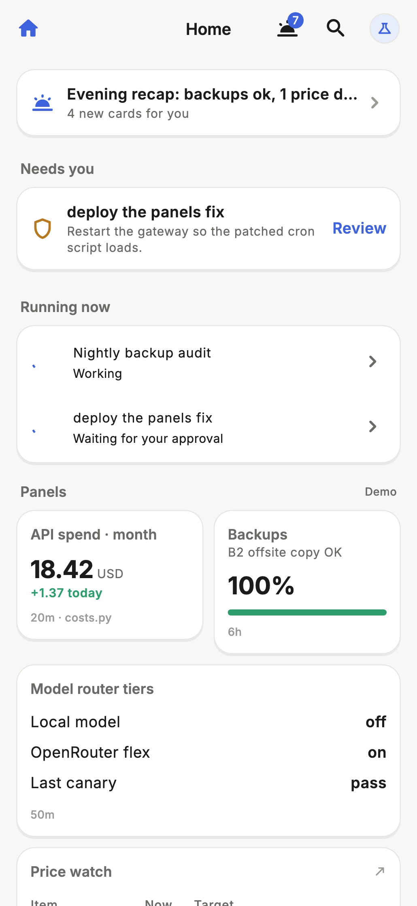
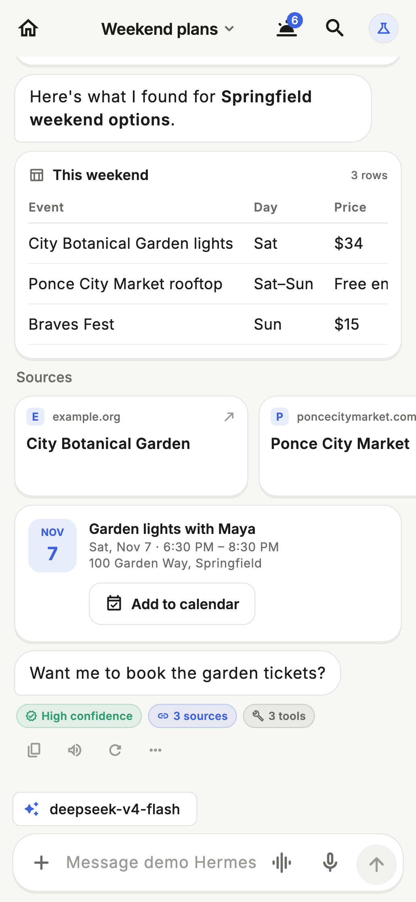
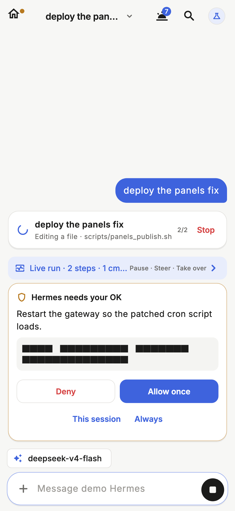
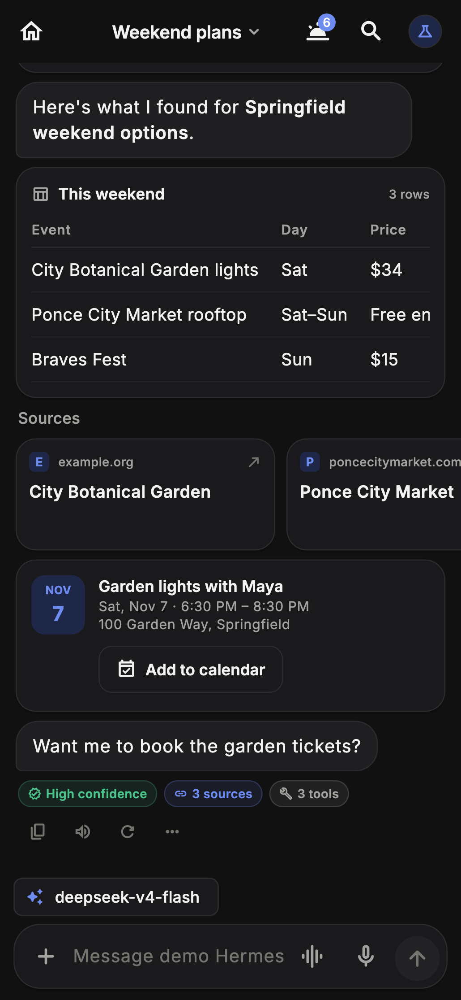

# Petasos

**Your Hermes Agent, in your pocket.** An unofficial, open-source Android app for a
self-hosted [Hermes Agent](https://hermes-agent.nousresearch.com/): a full mobile UI for your
agent, scheduled-task results pushed to your phone end-to-end encrypted, and (optionally) your
agent operating the phone for you.

[](https://github.com/bhargavmehta01/petasos/actions/workflows/build-apk.yml)
[](https://github.com/bhargavmehta01/petasos/releases/latest)
[](LICENSE)

<table><tr>
<td></td>
<td></td>
<td></td>
<td></td>
</tr></table>

> Petasos is a community project. It is **not affiliated with or endorsed by Nous Research**
> or the Hermes Agent project. It connects only to the Hermes server you run.

## Why Petasos

- **Cron results on your phone, privately.** Hermes cron jobs can deliver to `hermes_mobile`.
  The push itself carries no content: the phone wakes, then fetches the result from your own
  server over an authenticated session. `[SILENT]` output never notifies you.
- **The whole agent, not just chat.** Chats and projects, task cards with steps and Stop,
  inline approvals (deny, allow once, this session, always), skills, memory, scheduled tasks,
  cron studio, usage and cost, watchers, commitments, home panels your agent publishes.
- **Your agent can use your phone** (optional): approval-gated Android control through the
  Mobile Next MCP server over wireless ADB. See [docs/petasos-android-mobile-mcp.md](docs/petasos-android-mobile-mcp.md).
- **Self-hosted and private.** No account, no relay server, no analytics. Works over your LAN or
  Tailscale.
- **Try it without a server.** "Explore the demo" on the connect screen shows sample chats,
  cards and panels.

## Install

1. Download the latest `petasos-*-arm64.apk` from [Releases](https://github.com/bhargavmehta01/petasos/releases/latest)
   and check its SHA-256 against `SHA256SUMS.txt`.
2. Open it on your phone (allow "Install unknown apps" for your browser or file manager).
3. Enter your Hermes API server address (for example `http://100.64.12.34:8642` on Tailscale)
   and sign in.

Updates install in place: every official release is signed with the same key (fingerprint in
the release notes). Android 7.0+ (API 24), arm64.

**Optional: notifications for scheduled tasks.** Install the two server plugins from
[`server/`](server/) on your Hermes host, then turn on *Profile → Connection → Background
notifications* in the app and point cron jobs at `--deliver hermes_mobile`. Full guide:
[docs/hermes-mobile-cron-delivery.md](docs/hermes-mobile-cron-delivery.md).

## Build from source

```bash
git clone https://github.com/bhargavmehta01/petasos.git
cd petasos
flutter pub get
flutter test
flutter build apk --release --target-platform android-arm64 --split-per-abi
```

Requires Flutter 3.44.0 and Java 17. On a Mac, `bash scripts/build_hermes_mobile_mac.sh` runs the
complete test, build and signing pipeline. Architecture and engineering notes:
[docs/reference.md](docs/reference.md).

## Contributing

Issues and pull requests are welcome. Start with [CONTRIBUTING.md](CONTRIBUTING.md) and the
[good first issues](https://github.com/bhargavmehta01/petasos/labels/good%20first%20issue).
Security reports: see [SECURITY.md](SECURITY.md).

## Credits and licence

Petasos is built on **[rusty4444/hermes-android](https://github.com/rusty4444/hermes-android)**,
which provides the connection, streaming, approvals, push registration and turn-recovery engine.
Thank you, rusty4444. Petasos adds the new app UI, encrypted cron delivery and host tooling.

Petasos is licensed under [AGPL-3.0](LICENSE). Code from upstream remains available under its
original [MIT licence](LICENSES/MIT-hermes-android.txt). Details: [NOTICE.md](NOTICE.md).
